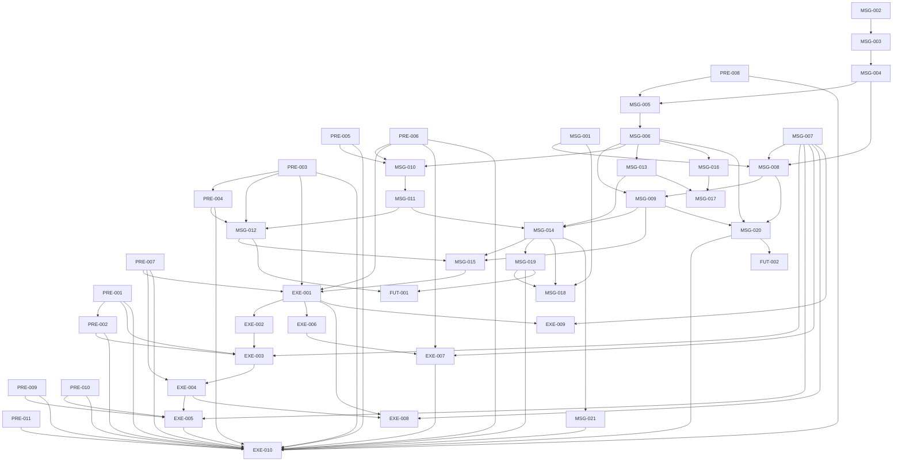

# Tickets, dependências e marcos

**44 rascunhos locais; nenhum publicado ou iniciado.** Decomposição pelo fluxo `to-tickets`, após consolidar a arquitetura. Arquivos numerados em ordem topológica; identificadores PRE/MSG/EXE/FUT são estáveis.

Leia [baseline](01-baseline-e-evidencias.md) e [arquitetura](02-arquitetura.md). Cada arquivo contém todos os campos solicitados, inclusive schema, API, env, segurança, LGPD, falhas, testes negativos, smoke e rollback.

## Decomposição para revisão

| Nº | Ticket | Classe | Blocked by | Entrega verificável |
|---|---|---|---|---|
| 1 | [PRE-001 — Registrar tentativa financeira antes da criação no Bling](issues/01-pre-001-registrar-tentativa-financeira-antes-da-criacao-no-bling.md) | BLOCKER | — | Ao lançar despesa contábil, persistir intenção e digest antes do POST; mostrar pendência quando a resposta não comprovar criação. Separar criação e baixa, sem retry automático ambíguo. |
| 2 | [PRE-002 — Reconciliar criação e baixa financeiras sem duplicar](issues/02-pre-002-reconciliar-criacao-e-baixa-financeiras-sem-duplicar.md) | BLOCKER | PRE-001 | Operador consulta a tentativa e resolve confirmação ou pendência com prova do Bling; retry humano usa a intenção original. |
| 3 | [PRE-003 — Arquivar produto e preservar itens históricos](issues/03-pre-003-arquivar-produto-e-preservar-itens-historicos.md) | BLOCKER | — | A ação de remover produto retira-o da venda sem apagar o produto ou itens de pedidos anteriores; tratar ativos, inativos e arquivados explicitamente. |
| 4 | [PRE-004 — Aplicar delete de produto Bling como tombstone](issues/04-pre-004-aplicar-delete-de-produto-bling-como-tombstone.md) | BLOCKER | PRE-003 | Webhook product.deleted arquiva/marca ausência remota e preserva histórico, sem cair no caminho de detalhe/upsert. |
| 5 | [PRE-005 — Aplicar delete de contato sem recriar cadastro](issues/05-pre-005-aplicar-delete-de-contato-sem-recriar-cadastro.md) | BLOCKER | — | Webhook contact.deleted marca contato removido/inativo sem inventar nome nem apagar vínculos de pedidos e casos. |
| 6 | [PRE-006 — Fechar escrita direta em catálogo, clientes, pedidos e estoque](issues/06-pre-006-fechar-escrita-direta-em-catalogo-clientes-pedidos-e-estoque.md) | BLOCKER | — | Inventariar browser/RPC/Realtime e migrar qualquer mutação legítima para comando autorizado; depois revogar DML direto dessas tabelas, mantendo leituras necessárias. |
| 7 | [PRE-007 — Fechar escrita direta financeira e fiscal](issues/07-pre-007-fechar-escrita-direta-financeira-e-fiscal.md) | BLOCKER | — | Restringir títulos, fornecedores, contas, categorias financeiras e documentos fiscais após provar callers legítimos e proteger comandos existentes. |
| 8 | [PRE-008 — Proteger mapeamento de conexões e escopo de integração](issues/08-pre-008-proteger-mapeamento-de-conexoes-e-escopo-de-integracao.md) | BLOCKER | — | Inventariar grants e impedir navegador de reatribuir tenant/account/segredo ou reativar conexão contornando API autorizada. |
| 9 | [PRE-009 — Unificar cadastro de fornecedor e consulta CNPJ](issues/09-pre-009-unificar-cadastro-de-fornecedor-e-consulta-cnpj.md) | BLOCKER | — | Cadastro devolve fornecedor selecionável na despesa; consulta usa serviço CNPJ existente e dados fiscais explícitos, sem inferir ICMS. |
| 10 | [PRE-010 — Remover inferência de ICMS da criação legada de contato](issues/10-pre-010-remover-inferencia-de-icms-da-criacao-legada-de-contato.md) | BLOCKER | — | Venda manual e demais callers de createContato transportam situação fiscal explícita ou encaminham dado ausente para decisão, sem CNPJ→contribuinte. |
| 11 | [PRE-011 — Alinhar entitlements Pro 4 e Enterprise 10](issues/11-pre-011-alinhar-entitlements-pro-4-e-enterprise-10.md) | BLOCKER | — | Catálogo, API e interface usam limites comerciais aprovados; tratar organizações acima do novo limite sem remover membros silenciosamente. |
| 12 | [MSG-001 — Levantar Chatwoot CE DEV com webhook real assinado](issues/12-msg-001-levantar-chatwoot-ce-dev-com-webhook-real-assinado.md) | FOUNDATION | — | Ambiente local reproduzível WSL2/Docker permite receber uma mensagem e entregar webhook assinado a endpoint de teste ORBITA. |
| 13 | [MSG-002 — Expandir identidade local Chatwoot sem colisão](issues/13-msg-002-expandir-identidade-local-chatwoot-sem-colisao.md) | FOUNDATION | — | Adicionar identidade UUID e vínculos compostos aos espelhos, com backfill validável e escrita compatível para a instalação existente. |
| 14 | [MSG-003 — Migrar ingestion, sync e UI Chatwoot para UUID local](issues/14-msg-003-migrar-ingestion-sync-e-ui-chatwoot-para-uuid-local.md) | FOUNDATION | MSG-002 | Jornada conectar→sincronizar→abrir conversa→enviar referencia UUID local, traduzindo id remoto somente no adapter correto. |
| 15 | [MSG-004 — Contrair chaves globais e liberar multi-instância](issues/15-msg-004-contrair-chaves-globais-e-liberar-multi-instancia.md) | FOUNDATION | MSG-003 | Remover dependência de PK externa global após comprovar migração de callers e permitir duas instalações reais independentes. |
| 16 | [MSG-005 — Aceitar webhook em inbox com dedup de entrega e revisão](issues/16-msg-005-aceitar-webhook-em-inbox-com-dedup-de-entrega-e-revisao.md) | FOUNDATION | MSG-004, PRE-008 | Webhook autentica, limita e persiste delivery/evento minimizado antes do ACK; created, edited e status repetido mantêm ocorrências legítimas. |
| 17 | [MSG-006 — Consumir inbox e abrir conversa/caso atomicamente](issues/17-msg-006-consumir-inbox-e-abrir-conversa-caso-atomicamente.md) | FOUNDATION | MSG-005 | Worker real transforma mensagem recebida em conversa e caso TRIAGE, visíveis ao operador, com conclusão da inbox na mesma transação. |
| 18 | [MSG-007 — Representar efeito ambíguo e impedir retry inseguro na outbox](issues/18-msg-007-representar-efeito-ambiguo-e-impedir-retry-inseguro-na-outbox.md) | FOUNDATION | — | Outbox distingue não enviado, recusado, confirmado e UNKNOWN; operador vê por que uma tentativa não pode ser repetida. |
| 19 | [MSG-008 — Enviar Chatwoot por consumidor real com identidade estável](issues/19-msg-008-enviar-chatwoot-por-consumidor-real-com-identidade-estavel.md) | FOUNDATION | MSG-004, MSG-007, MSG-001 | Enviar no cockpit ORBITA registra intenção transacional e worker entrega ao Chatwoot; status sent exige recibo, ambiguidade aparece ao operador. |
| 20 | [MSG-009 — Assumir e devolver atendimento com versão e nota privada](issues/20-msg-009-assumir-e-devolver-atendimento-com-versao-e-nota-privada.md) | MVP | MSG-006, MSG-008 | Atendente assume/devolve conversa; sistema pausa respostas futuras da IA e registra resumo/nota privada e responsável. |
| 21 | [MSG-010 — Vincular cliente/pedido com verificação e consultas mínimas](issues/21-msg-010-vincular-cliente-pedido-com-verificacao-e-consultas-minimas.md) | MVP | MSG-006, PRE-005, PRE-006 | Atendimento verifica associação do solicitante ao cliente antes de revelar pedido; casos ambíguos recebem pergunta neutra ou humano. |
| 22 | [MSG-011 — Consultar pedido, itens, rastreio, pagamento e estoque com frescor](issues/22-msg-011-consultar-pedido-itens-rastreio-pagamento-e-estoque-com-frescor.md) | MVP | MSG-010 | Operador e tools leem um retrato mínimo do pedido verificado, itens e situação operacional, distinguindo desconhecido/desatualizado. |
| 23 | [MSG-012 — Recomendar até três alternativas válidas de produto](issues/23-msg-012-recomendar-ate-tres-alternativas-validas-de-produto.md) | MVP | MSG-011, PRE-003, PRE-004 | Caso com item sem estoque recebe até três alternativas compatíveis, com score explicável e diferença de preço calculada. |
| 24 | [MSG-013 — Executar triagem IA estruturada com orçamento e contexto mínimo](issues/24-msg-013-executar-triagem-ia-estruturada-com-orcamento-e-contexto-minimo.md) | MVP | MSG-006 | Mensagem sintética gera intenção/motivo/entidades/perguntas em schema versionado; operador vê resultado e falhas explicitamente. |
| 25 | [MSG-014 — Responder com fatos validados e encaminhar resumo humano](issues/25-msg-014-responder-com-fatos-validados-e-encaminhar-resumo-humano.md) | MVP | MSG-009, MSG-011, MSG-013 | Cliente recebe resposta sustentada por tools; falta de prova, ambiguidade ou política exigindo humano gera handoff com resumo privado. |
| 26 | [MSG-015 — Propor, editar e decidir resolução sem executar troca](issues/26-msg-015-propor-editar-e-decidir-resolucao-sem-executar-troca.md) | MVP | MSG-009, MSG-012, MSG-014 | Atendente vê proposta com três alternativas quando disponíveis e delta; aprovar/rejeitar/editar registra decisão auditada, sem efeitos de ERP. |
| 27 | [MSG-016 — Receber fotos em quarentena e disponibilizar evidência segura](issues/27-msg-016-receber-fotos-em-quarentena-e-disponibilizar-evidencia-segura.md) | MVP | MSG-006 | Foto inbound vira evidência privada escaneada; atendente autorizado visualiza derivado seguro ou motivo de rejeição. |
| 28 | [MSG-017 — Analisar foto como inferência estruturada revisável](issues/28-msg-017-analisar-foto-como-inferencia-estruturada-revisavel.md) | MVP | MSG-016, MSG-013 | Evidência clean gera descrição e hipóteses úteis de triagem, sempre distinguindo inferência de fato operacional. |
| 29 | [MSG-019 — Validar evals e sabotagem da jornada de atendimento](issues/29-msg-019-validar-evals-e-sabotagem-da-jornada-de-atendimento.md) | MVP | MSG-014 | Suite sintética versionada mede acurácia, grounding, handoff e segurança; resultado vira gate para habilitar autorresposta. |
| 30 | [MSG-018 — Demonstrar canal Meta oficial em número de teste](issues/30-msg-018-demonstrar-canal-meta-oficial-em-numero-de-teste.md) | MVP | MSG-001, MSG-014, MSG-019 | Número Meta de teste recebe/responde no Chatwoot e realiza jornada completa com dados sintéticos e handoff. |
| 31 | [MSG-020 — Operar piloto com métricas, backup e reconciliação](issues/31-msg-020-operar-piloto-com-metricas-backup-e-reconciliacao.md) | HARDENING | MSG-006, MSG-008, MSG-009 | Ambiente compartilhado tem worker supervisionado, alertas de backlog/UNKNOWN e operador consegue reconciliar sem retry indiscriminado. |
| 32 | [MSG-021 — Fechar privacidade, PII e liberação de dados reais](issues/32-msg-021-fechar-privacidade-pii-e-liberacao-de-dados-reais.md) | HARDENING | MSG-014 | Responsável aprova matriz de dados/provedores e retenção; acesso, exportação e deleção de conversas/IA são verificáveis antes de usar dados reais. |
| 33 | [EXE-001 — Revalidar aprovação e política no comando de troca](issues/33-exe-001-revalidar-aprovacao-e-politica-no-comando-de-troca.md) | FUTURE | MSG-015, PRE-003, PRE-006, PRE-007 | Comando de troca autorizado consome proposta aprovada atual e registra execução local; alterações de ator, preço, estoque ou política impedem execução. |
| 34 | [EXE-002 — Criar substituto local bloqueado e reservar estoque](issues/34-exe-002-criar-substituto-local-bloqueado-e-reservar-estoque.md) | FUTURE | EXE-001 | Troca aprovada produz rascunho substituto e reserva atômica, mostrando bloqueio e prazo; cancelamento/expiração libera uma vez. |
| 35 | [EXE-003 — Criar cobrança da diferença no PSP do lojista](issues/35-exe-003-criar-cobranca-da-diferenca-no-psp-do-lojista.md) | FUTURE | EXE-002, MSG-007, PRE-001, PRE-002 | Delta positivo gera uma intenção de pagamento da conta do lojista, com URL segura e estado; retorno do cliente não confirma liquidação. |
| 36 | [EXE-004 — Confirmar pagamento e autorizar fulfillment no servidor](issues/36-exe-004-confirmar-pagamento-e-autorizar-fulfillment-no-servidor.md) | FUTURE | EXE-003, PRE-007 | Webhook assinado confirma valor/moeda/conta e libera autorização transacional de emissão/envio; status da UI não é autoridade. |
| 37 | [EXE-005 — Publicar pedido substituto no Bling com reconciliação](issues/37-exe-005-publicar-pedido-substituto-no-bling-com-reconciliacao.md) | FUTURE | EXE-004, MSG-007, PRE-009, PRE-010 | Substituto autorizado chega ao ERP com referência durável e sem alterar pedido original; ACK perdido gera reconciliação. |
| 38 | [EXE-006 — Registrar retorno esperado e recebimento parcial sem restock](issues/38-exe-006-registrar-retorno-esperado-e-recebimento-parcial-sem-restock.md) | FUTURE | EXE-001 | Operador registra itens esperados e lotes recebidos, vinculados à troca; recebimento apenas muda custódia. |
| 39 | [EXE-007 — Inspecionar retorno e lançar disposição uma única vez](issues/39-exe-007-inspecionar-retorno-e-lancar-disposicao-uma-unica-vez.md) | FUTURE | EXE-006, MSG-007, PRE-006 | Inspeção aprovada decide RESTOCK/DAMAGED/DISCARD/RETURN_TO_SUPPLIER por lote; estoque só muda para quantidade vendável confirmada. |
| 40 | [EXE-008 — Executar estorno de diferença sob política e aprovação](issues/40-exe-008-executar-estorno-de-diferenca-sob-politica-e-aprovacao.md) | FUTURE | EXE-001, EXE-004, MSG-007 | Quando política seleciona estorno, operador autorizado confirma devolução monetária limitada ao saldo elegível e acompanha reconciliação. |
| 41 | [EXE-009 — Emitir crédito ou voucher conforme política escolhida](issues/41-exe-009-emitir-credito-ou-voucher-conforme-politica-escolhida.md) | FUTURE | EXE-001, MSG-007 | Uma política comercial selecionada permite emitir e consultar crédito OU voucher com saldo/validade auditáveis; não implementar ambos por antecipação. |
| 42 | [EXE-010 — Liberar execução controlada com gates objetivos e kill switch](issues/42-exe-010-liberar-execucao-controlada-com-gates-objetivos-e-kill-switch.md) | FUTURE | PRE-001, PRE-002, PRE-003, PRE-004, PRE-005, PRE-006, PRE-007, PRE-008, PRE-009, PRE-010, PRE-011, MSG-019, MSG-020, MSG-021, EXE-005, EXE-007 | Piloto permite somente comandos determinísticos expressamente aprovados/politicamente autorizados; botão de suspensão bloqueia novos efeitos e preserva reconciliação. |
| 43 | [FUT-001 — Avaliar ganho de embeddings no ranking](issues/43-fut-001-avaliar-ganho-de-embeddings-no-ranking.md) | FUTURE | MSG-012, MSG-019 | Benchmark compara ranking atual com embeddings/reranking usando catálogo sintético/consentido; adotar somente se ganho justificar custo. |
| 44 | [FUT-002 — Avaliar Queues ou Workflow com carga observada](issues/44-fut-002-avaliar-queues-ou-workflow-com-carga-observada.md) | FUTURE | MSG-020 | Usar métricas reais redigidas para decidir se worker PostgreSQL exige transporte gerenciado ou orquestração longa. |

## Grafo completo



## Gates de habilitação

Arestas são dependências de implementação/teste. Gates são requisitos para habilitar a capacidade com público/dados/efeitos reais. Uma fatia pode ser mergeável com flag desligada sem estar liberada operacionalmente. Nenhuma dessas ações foi executada nesta sessão.

- **Laboratório sintético:** fundações podem avançar isoladamente; nenhum dado produtivo é fixture.
- **Autorresposta:** MSG-009, MSG-014 e MSG-019 comprovados, com kill switch.
- **Piloto read-only real:** PRE-003/004/005/006/007/008; MSG-004/005/006/008/009/010/011/014/019/020/021. PRE-011 antes de vender planos com novos limites; MSG-018 para WhatsApp. FIN-01 ainda bloqueia criação financeira enquanto não fechado.
- **Foto/visão real:** MSG-016/017 e extensão comprovada de MSG-021; autorização para texto não cobre automaticamente imagens.
- **Troca/pagamento/estoque:** todos PRE-001…011, políticas/PSP definidos, EXE-001…007 relevantes comprovados, MSG-020/021 e EXE-010. Estorno exige EXE-008; crédito/voucher EXE-009. Sem política negativa implementada, manter esse caso em humano.
- **Autonomia futura por política:** aprovação explícita das alçadas por organização e tipo de comando. O LLM continua sem ferramentas destrutivas. EXE-010 habilita execução controlada, não autonomia irrestrita.

## Tickets que fecham os P0 e lacunas

| Achado | Tickets | Prova |
|---|---|---|
| FIN-01 | PRE-001 + PRE-002 | ACK perdido de criação/baixa, identidade durável e reconciliação sem segundo POST |
| WH-01 | PRE-004 + PRE-005; lifecycle em PRE-003 | Delete mínimo, replay e update atrasado sem upsert/ressurreição |
| SEC-01 | PRE-006 + PRE-007 + PRE-008 | Inventário de callers; Data API/RPC negam bypass por authenticated |
| Histórico de produto | PRE-003 | Arquivado não vende; pedidos e itens permanecem |
| Fornecedor/ICMS | PRE-009 + PRE-010 | Jornada com DTO correto e indicador independente de CNPJ |
| Entitlements | PRE-011 | Pro 4/Enterprise 10, concorrência e legado definidos |
| Colisão Chatwoot | MSG-002 + MSG-003 + MSG-004 | Duas instalações com os mesmos IDs sem sobrescrever |
| Dedup/atomicidade/crash | MSG-005 + MSG-006 | Revisões legítimas, ACK após commit e retomada sem estado parcial |
| Envio/retry Chatwoot | MSG-007 + MSG-008 | Worker real, chave estável, corte inline e UNKNOWN conciliável |

FIN-01/WH-01/SEC-01 são os P0 informados no pedido. Achados adicionais são blockers funcionais/de segurança, sem atribuir severidade de pentest não executado.

## Milestones e critical path

**M0 — corrigir base:** PRE-001…011 em trilhas independentes. Não existe dependência artificial FIN→Chatwoot DEV; a liberação de efeitos reais continua bloqueada.

**M1 — canal sem IA:** MSG-001; MSG-002→003→004; PRE-008→MSG-005→006; MSG-007→008; MSG-009. Prova: receber, responder humanamente, reiniciar e recuperar sem mistura de tenants.

**M2 — primeiro MVP demonstrável:** M1 + PRE-003/004/005/006/007 + MSG-010→011; MSG-013→014→019→018. Número Meta de teste envia mensagem sintética, IA entende, consulta pedido/estoque autorizado, responde e encaminha resumo privado ao humano. Sem executar troca. Dados reais/ambiente compartilhado adicionam MSG-020/021.

**M3 — propostas e fotos:** MSG-012→015 e MSG-016→017, com evals/privacidade estendidas. Não bloquear a primeira demo textual por ranking avançado/visão. Aprovação desta fase não dispara execução.

**M4 — execução controlada:** EXE-001→002→003→004→005, em paralelo EXE-001→006→007, convergindo em EXE-010. Pagamento e guard vêm antes do efeito ERP. Selecionar EXE-008 ou EXE-009 para política negativa, se desejada.

**M5 — otimizações:** FUT-001/FUT-002 somente com evidência de ganho/carga; não atrasam M2.

```text
MSG-002 → 003 → 004 → 005 → 006 → 010 → 011 ┐
                              ├→ 013 ──────┤
MSG-001 + MSG-007 + MSG-004 → 008 → 009 ────┤
                                           └→ MSG-014 → 019 → 018
PRE-005/006 → MSG-010; PRE-008 → MSG-005
```

Este é o critical path técnico, não estimativa temporal. Esforço 1–3 é relativo. Medir velocidade das primeiras fatias antes de prometer dias. Se inventário de callers exceder um contexto de implementação, dividir a fatia antes de codificar e atualizar blockers; não improvisar mega-PR.

## Decisões da proprietária

| Decisão | Escopo | Enquanto pendente |
|---|---|---|
| D1 | Starter, grandfathering e vigência | Não remover membros nem alterar cobrança retroativa |
| D2 | Verificação do cliente | Humano antes de revelar pedido |
| D3 | Acesso/teto de IA DEV | Fake explícito; modelo real somente sintético com teto |
| D4 | WABA/número/templates Meta | Inbox local sintética |
| D5 | Host/região/custo/backup/plantão | WSL2 local; Oracle opcional de laboratório |
| D6 | Base, DPA, região, retenção/imagens | Bloquear dados reais no modelo |
| D7 | Elegibilidade, alçadas, prazo e retorno antes do envio | Somente propostas |
| D8 | PSP e merchant do lojista | Nenhuma cobrança SAC; billing ORBITA separado |
| D9 | Bloqueio ERP e permissões externas | Não habilitar se houver bypass de emissão/envio |
| D10 | Estorno, crédito ou voucher | Decisão humana sem política inventada |
| D11 | Rollout e alçadas automatizáveis | Execução desligada |

Pro=4/Enterprise=10 e Meta oficial já são requisitos recebidos, não decisões reabertas. Pendências bloqueiam as capacidades correspondentes, não a conclusão do planejamento.

## Aprovação da decomposição

A skill local determina: **“Iterate until the user approves the breakdown.”** A entrega é completa para revisão, mas permanece draft. Não foram publicadas issues externas ou tickets ready-for-agent. O pedido também fala em plano aprovado; não há aprovação desta decomposição registrada.

Revisar uma vez a granularidade, as arestas e eventuais divisões/uniões. Após aprovação, promover os arquivos locais ao status acordado, sem iniciar o primeiro ticket nesta sessão. Publicação externa exige destino/autorização próprios.

**Próxima ação única:** aprovar ou ajustar a arquitetura e estes 44 rascunhos.
