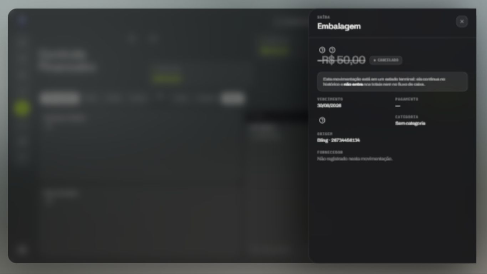
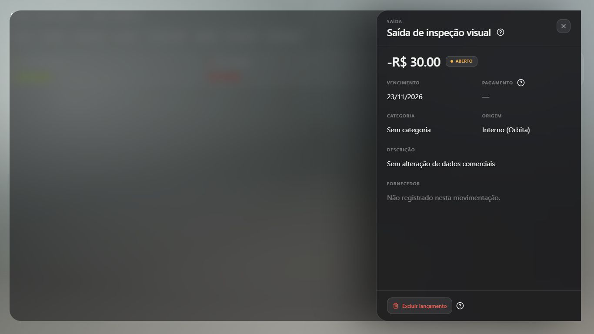
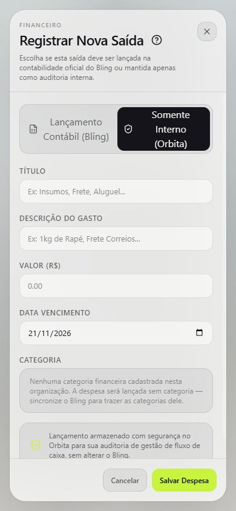
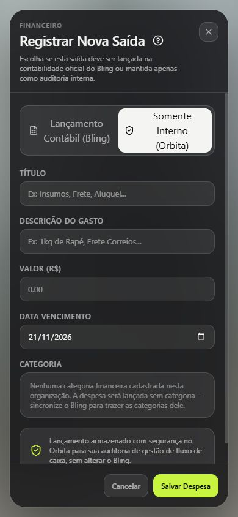
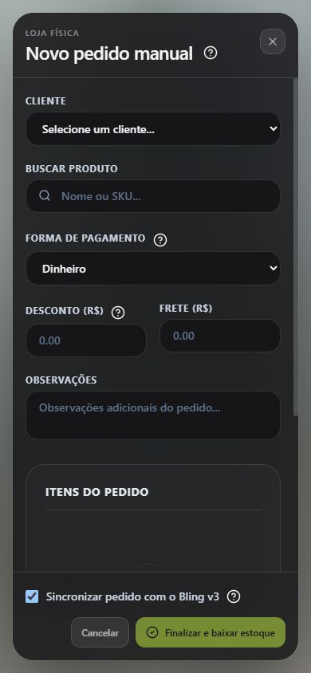

# Revisão de layout HelpInfo — 21/11/2026

Correção visual sobre main `f333ae6`, em branch isolada. Não altera catálogo de textos, contratos, cálculos, autorização, banco, Bling, workers ou bot.

## Causas reproduzidas

- `ResumoFinanceiro` recebia uma ajuda como quarta célula da grade de três indicadores. A ajuda agora acompanha o contexto “Resumo financeiro” no cabeçalho.
- No detalhe financeiro, a ajuda de pagamento era uma célula própria entre Pagamento e Categoria. Deslocava Categoria e Origem. Agora integra o rótulo de Pagamento.
- Ajudas de detalhe/correção apareciam duplicadas e sem contexto no corpo do drawer e da confirmação. Agora acompanham título ou ação de correção.
- Ajuda como primeiro filho dos corpos de Nova despesa, Fornecedor e outros modais criava linhas próprias antes do formulário. O Modal recebeu uma área de ajuda junto ao título, fora do nome acessível e do corpo.
- Rótulos e títulos em contêineres verticais deixavam o ícone em outra linha. `HelpContext` agrupa o controle e sua ajuda, sem inserir a ajuda dentro de botões ou labels.
- O acionador passava de 28 para 44 px em dispositivos de toque. Agora conserva 28 × 28 px em ambos, com foco visível e sem mudança de geometria. O botão de fechar ajuda mantém 44 px.
- Cabeçalhos de indicadores extrapolavam 390 px. A composição afetada permite duas linhas e duas colunas de indicadores nesse tamanho; o desktop conserva sua composição. A regra fica em CSS Module, aplicada apenas aos cabeçalhos revisados.
- O corpo flex do Modal não declarava `min-height: 0`, e cabeçalho/rodapé podiam encolher. Agora o corpo rola e os extremos permanecem acessíveis. O ajuste de margens e padding móvel está restrito ao Modal, sem alterar tokens globais.
- A inspeção manual da venda em 390 px revelou sobreposição entre destino e ações no rodapé. Os grupos agora ficam em duas linhas no celular; teste específico verifica que a caixa do destino termina antes dos botões.

## Financeiro e evidência visual

A reprodução anterior foi feita em staging autenticado, sem salvar operações. Antes de alterar, a ajuda de Nova despesa já passava por Escape, retorno do foco e preservação do título digitado. Portanto, a suspeita de falha intrínseca do Radix não se confirmou e seu mecanismo foi preservado.

As capturas posteriores usam os componentes reais e o CSS global da aplicação em uma página local de inspeção, com dados sintéticos e portas de escrita bloqueadas. Não equivalem a teste de gravação, consulta à Receita, sincronização ou integração comercial. A prévia Next autenticada depende do login normal do usuário; não houve extração de sessão do staging.

Antes (registro real cancelado) e depois (registro sintético aberto) demonstram a diferença estrutural; são registros distintos, e não uma alteração da mesma despesa:

Nova despesa em 390 × 844, com cabeçalho e rodapé acessíveis:

Rodapé da venda manual em 390 px, com destino e ações separados:

Validados em 390 × 844, 768 × 1024, 1366 × 768 e 1920 × 1080, nos temas claro e escuro: despesa interna e contábil, rolagem até fornecedor, cadastro de fornecedor, detalhe avulso, confirmação de exclusão local e confirmação de cancelamento Bling. Nenhuma confirmação destrutiva foi executada. O tema claro é selecionado somente pela página de inspeção: o produto ainda não oferece um seletor de tema claro.

Os testes verificam limites do viewport, overflow horizontal dos diálogos, foco preso na ajuda, Escape fechando apenas a ajuda, retorno ao acionador e manutenção de título/valor da despesa. A abertura da ajuda não submete formulários nem alterna o destino Bling.

## Cobertura e coordenação com #157

A matriz JSON/CSV rastreia as 66 ajudas ativas, com arquivos e linhas atualizados por `node scripts/update-helpinfo-matrix.mjs`. `legado.pedidos` permanece a exceção histórica já registrada; não é uma 67ª ajuda ativa. O catálogo está byte a byte preservado.

As 66 montagens foram revisadas no código; 64 têm posição aprovada nesta composição. Duas exceções de posicionamento são deliberadamente mantidas para coordenação:

| Ajuda | Situação |
|---|---|
| `sac.controle` | Reposicionamento junto do estado do atendimento já consta no PR #157, HEAD `5025ba2`. O arquivo reescrito por Claude foi preservado. |
| `sac.envio` | Reposicionamento junto do campo e ação Enviar já consta no novo Compositor do PR #157. O compositor atual foi preservado. |

`sac.lista` já aparece no cabeçalho da lista e permanece preservada. Nos painéis Cliente, Pedido, Rascunho e Triagem, a alteração se limita à posição do ícone. No arquivo Triagem, o diff do #157 altera somente assinatura/estado sem caso, em região distinta.

Não se declara que as 66 montagens foram vistas em todas as combinações de tela/tema. Há revisão de código completa, teste de abertura/foco das 66 ajudas, inspeção visual prioritária do Financeiro e verificação dos componentes reais de produto, contato, venda manual e cabeçalho do painel. Os cenários de Mensageria continuam separados dos serviços reais.

Antes de mesclar, atualizar esta branch após #157 e regenerar a matriz, conciliando apenas a documentação das novas localizações. Não mesclar este PR com a afirmação de que as duas exceções já foram corrigidas na main atual.

## Componentes corrigidos

- Infraestrutura visual: HelpContext, HelpInfo.module.css, Modal e Modal.module.css.
- Financeiro: cabeçalho/composição, resumo, filtros, ações, gráficos, pendências, NovaDespesaModal, NovoFornecedorModal e DetalheDaMovimentacao.
- Produtos: EstoqueEProdutos, ProductDetailModal, SecaoDoProduto, ImagemDoProduto e confirmação de arquivamento.
- Vendas: VendasEPedidos, ManualOrderModal, EditOrderModal, PendenciasDeVendaManual, DrawerDoPedido e CancelamentoDePedido.
- Clientes: ClientesEContatos, ClienteDetailModal, ClienteEditModal e ConsultaDeCnpj.
- Organização: OrganizationPanel, OrganizationList, MembersList, ListaDeConvites e modais de criar organização, criar/aceitar convite.
- Integrações: IntegrationsPanel, MensagensRecebidas e EnviosComAtencao.
- Painel, plano, login, diagnóstico e shell: VisaoGeral, AreaAnalitica, BillingPanel, TelaDeEntrada, ErrorLogModal e grupos de organização/sincronização em page.tsx.
- Mensageria: apenas posicionamento em PainelDaResposta, PainelDaTriagem, PainelDoCliente e RetratoDoPedido.

## Regressão executável

`npm run test:helpinfo:visual` inicia somente a inspeção local, sem credenciais. Instalar previamente o Chromium de teste com `npx playwright install chromium`. A suíte gera capturas no relatório Playwright, publicado como artefato `helpinfo-visual` pelo CI.

- Oito cenários financeiros: quatro resoluções × dois temas, incluindo toque em 390 px.
- Um cenário de teclado para as 66 ajudas.
- Quatro cenários de integridade dos cabeçalhos.
- Quatro cenários de produto, contato e venda manual.
- Teste unitário de venda manual atualizado para garantir que a ajuda compartilha o contexto do checkbox no rodapé sem alterar seu valor nem iniciar venda.

Conclusão visual: os modais financeiros inspecionados preservam campos, rolagem, foco, conteúdo e ações. A comprovação cobre a interface; não afirma ter executado operações comerciais reais. CI e preview devem estar aprovados no HEAD final antes de qualquer merge, que exige autorização do usuário.
